# hyprnixos

My NixOS laptop setup in one flake:

- **Hyprland**, configured in Lua
- **Quickshell island** at the top of the screen: control center, Wi-Fi and Bluetooth menus, launcher, workspaces, media, calendar, notifications and system prompts
- **SDDM login** and **lock screen** themed to match
- **Home Manager** for apps and dotfiles
- **agenix** ready for secrets (none yet)

## Where to change things

| What | Where |
| --- | --- |
| Wallpaper | `assets/wallpaper.jpg` |
| Avatar (login, lock, gateway) | `assets/avatar.jpg` |
| Login / lock wallpaper | `dotfiles/quickshell/assets/wallpaper.jpg` |
| Monitors | `hosts/<name>/home.nix` |
| Keybinds | `dotfiles/hypr/binds.lua` |
| Window rules | `dotfiles/hypr/rules.lua` |
| Hyprland colours | `dotfiles/hypr/colors.lua` |
| Island colours and sizes | `dotfiles/quickshell/panels/island/IslandTheme.qml` |
| Apps | `modules/home/apps.nix` |
| System packages and services | `modules/nixos/` |
| Hotspots and known networks | `~/.local/state/quickshell/preferred-networks.json` (kind `1` known, `2` hotspot) |
| Login screen theme | `modules/nixos/sddm/theme/` |

Files in `dotfiles/` are symlinked, so changes apply on save. Everything else needs a rebuild.

## Layout

| Path | What |
| --- | --- |
| `flake.nix` | inputs + one `nixosConfigurations.<host>` line per laptop |
| `hosts/<name>/` | the only machine-specific config: hardware, boot, monitors |
| `modules/nixos/` | shared system config (`default.nix` imports all) |
| `modules/home/` | shared Home Manager config (`default.nix` imports all) |
| `dotfiles/hypr/` | Hyprland Lua + hypridle/hyprpaper |
| `dotfiles/quickshell/` | Quickshell config, linked to `~/.config/quickshell` |
| `assets/` | wallpaper, avatar |
| `docs/` | this README, its screenshots, and rules for working in this repo (`Context.md`) |

Clone the repo to `~/hyprnixos` (the dotfile links point there).

## Apply

```sh
nix flake check
nixos-rebuild build --flake .#latitude-7340
sudo nixos-rebuild switch --flake .#latitude-7340
```

## Login screen problems

- Logs: `journalctl -b -u display-manager`.
- If it doesn't appear, press Ctrl+Alt+F2, log in, and run `sudo nixos-rebuild switch --rollback`.

## New laptop

1. Install NixOS, `git clone <repo> ~/hyprnixos`.
2. `mkdir hosts/<new>` and `nixos-generate-config --show-hardware-config > hosts/<new>/hardware-configuration.nix`.
3. Copy `default.nix` and `home.nix` from an existing host. Change boot, hardware quirks and monitors. Keep the new machine's `stateVersion`s.
4. Add `<new> = mkHost "<new>";` to `nixosConfigurations` in `flake.nix`.
5. `git add .` then `sudo nixos-rebuild switch --flake .#<new>` and reboot.

## Screenshots

<table>
<tr>
<td width="25%" align="center" valign="middle">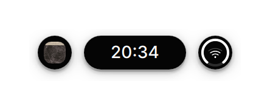</td>
<td width="25%" align="center" valign="middle">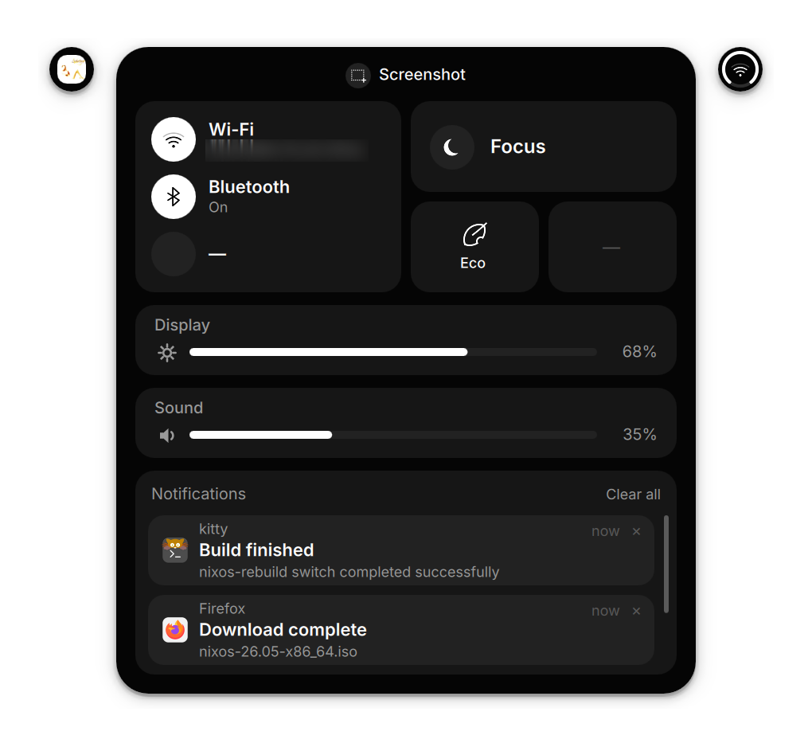</td>
<td width="25%" align="center" valign="middle">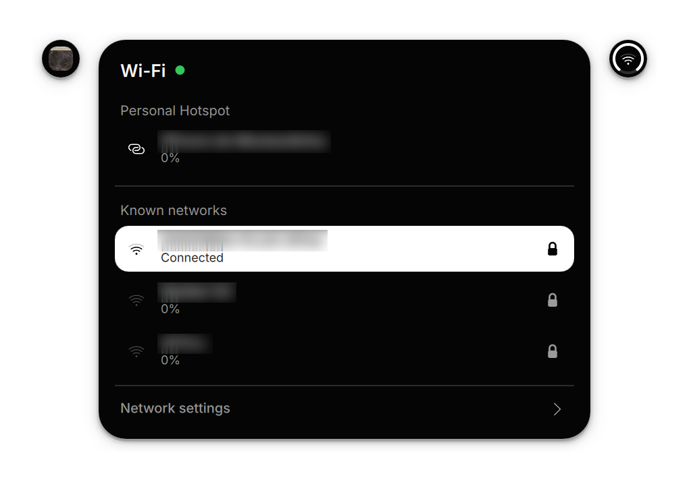</td>
<td width="25%" align="center" valign="middle">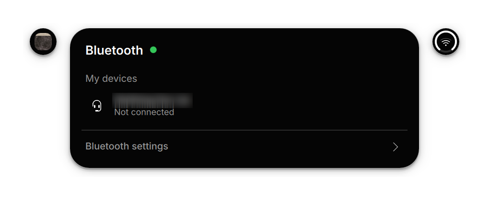</td>
</tr>
<tr>
<td align="center" valign="middle">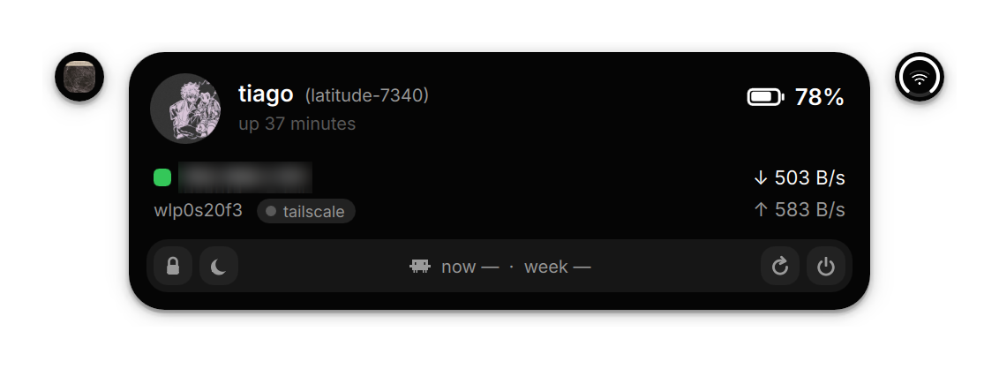</td>
<td align="center" valign="middle">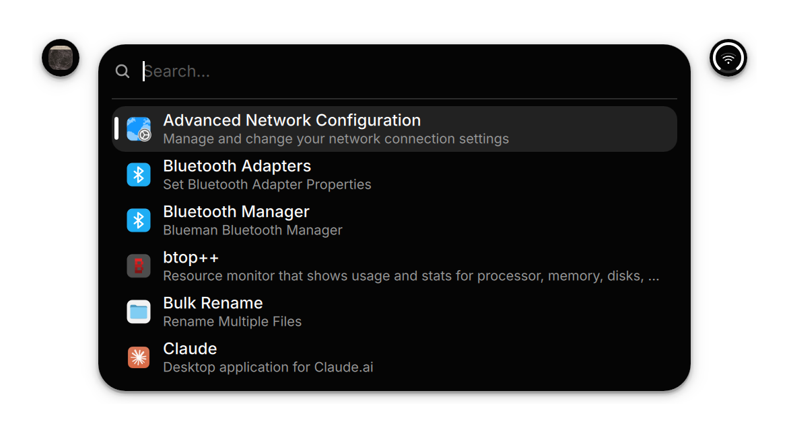</td>
<td align="center" valign="middle">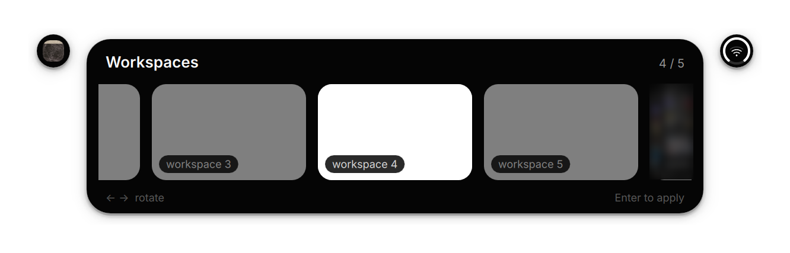</td>
<td align="center" valign="middle">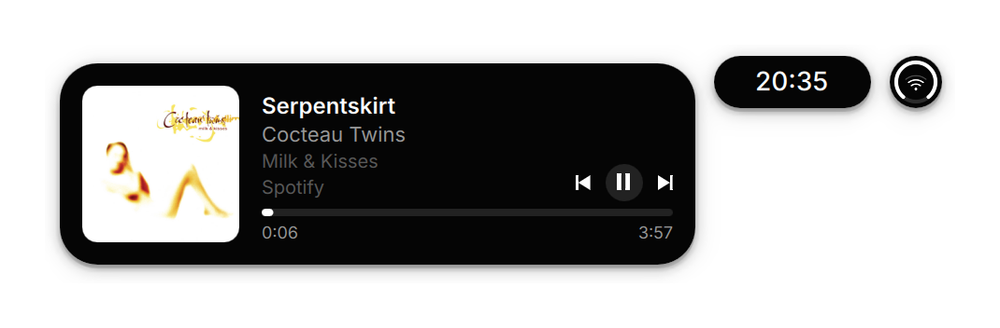</td>
</tr>
<tr>
<td align="center" valign="middle">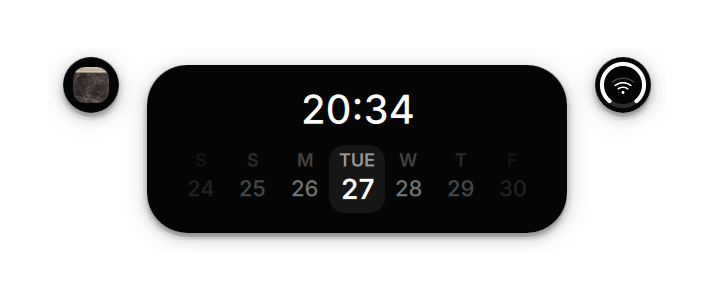</td>
<td align="center" valign="middle">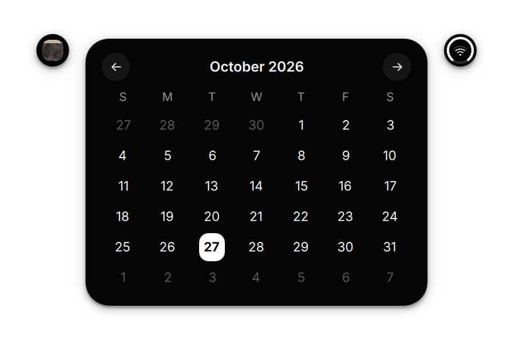</td>
<td align="center" valign="middle">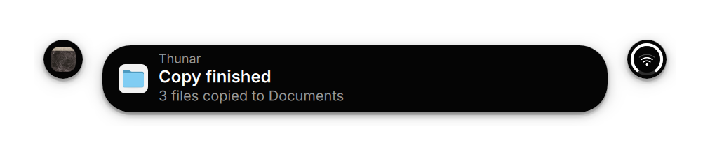</td>
<td align="center" valign="middle">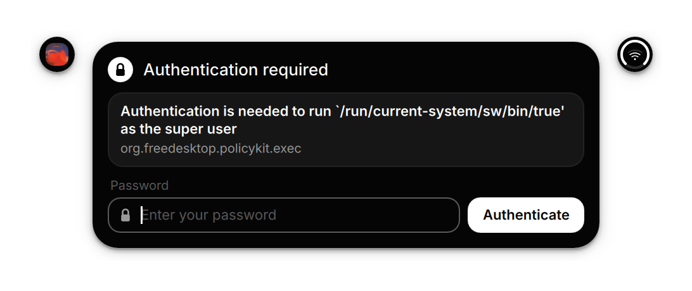</td>
</tr>
<tr>
<td align="center" valign="middle">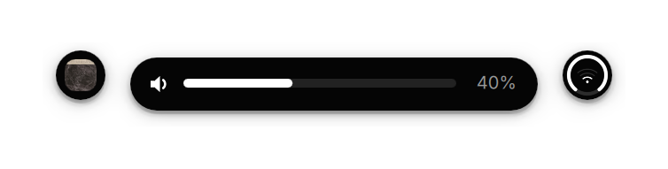</td>
<td align="center" valign="middle">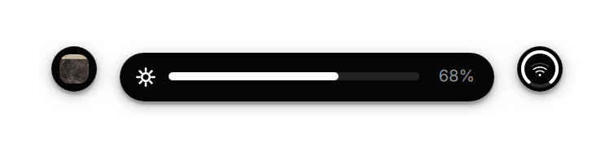</td>
<td align="center" valign="middle">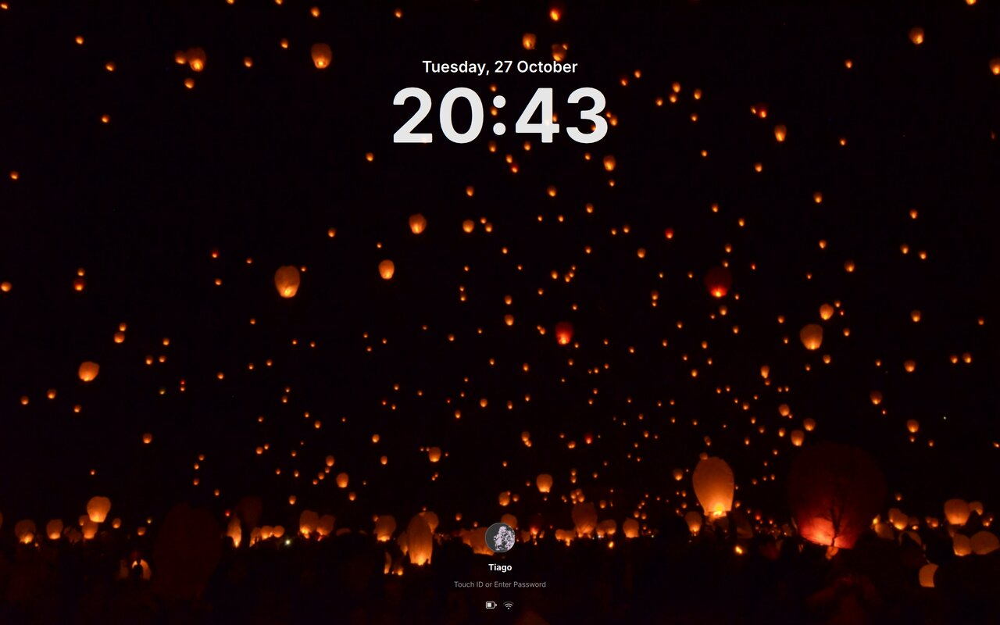</td>
<td align="center" valign="middle">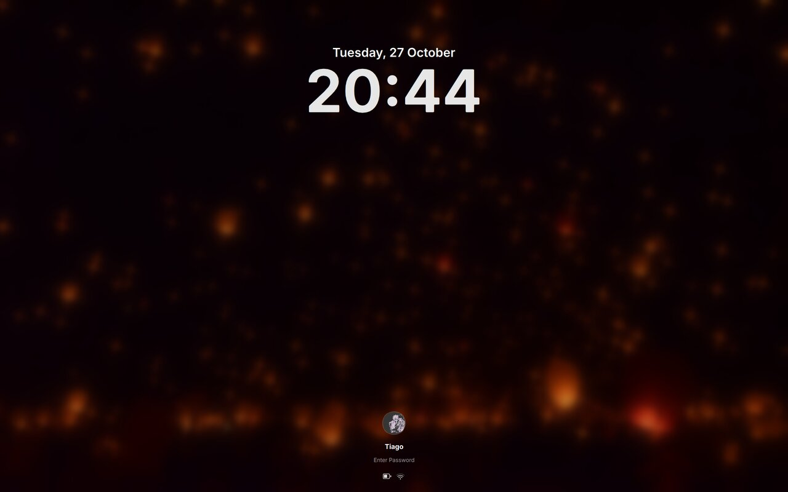</td>
</tr>
</table>
